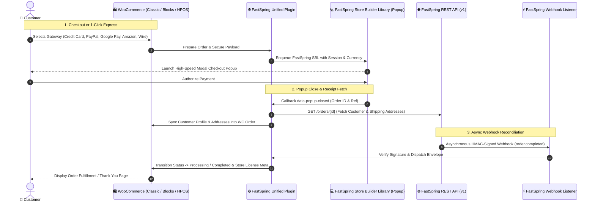

# FastSpring Unified Payment Gateway for WooCommerce

[](https://wordpress.org)
[](https://woocommerce.com)
[](https://www.php.net)
[]()
[]()
[]()

An enterprise-level **FastSpring Payment Gateway, Subscription Management & Express Checkout** extension for **WooCommerce**. Engineered to split FastSpring's monolithic checkout into distinct, unbundled payment methods directly within the native WooCommerce checkout experience—featuring automated chargeback handling, 1-click Express Checkout buttons, bi-directional subscription synchronization, FastSpring Accounts API provisioning, and full WooCommerce Blocks & HPOS compatibility.

---

## 🏗️ Architecture & Payment Flow



---

## 🌟 Comprehensive Feature Matrix

### 1. 🔀 Decomposed Multi-Gateway Architecture
Replaces generic hosted payment redirects with dedicated, branded payment methods:
- 💳 **Credit & Debit Cards:** Visa, MasterCard, American Express, Discover, JCB, Diners Club, UnionPay, Maestro.
- 🅿️ **PayPal Express:** Native FastSpring PayPal checkout bridge.
- 📱 **Google Pay:** Modern browser payment sheet integration.
- 📦 **Amazon Pay:** Seamless checkout using stored Amazon buyer credentials.
- 🏦 **Wire Transfer / ACH:** B2B bank transfer workflow with offline-to-online reconciliation.
- 🎨 **Dynamic SVG Icon Picker:** Customizable payment brand badges for each sub-gateway with live admin preview.

### 2. ⚡ Express Checkout ("Buy Now" Fast Checkout)
- **1-Click Purchases:** Renders high-converting **"Buy Now with FastSpring"** express checkout buttons directly on:
  - Single Product Pages (above or below Add to Cart)
  - Cart Page
  - Mini-Cart Drawer
- **AJAX Order Builder:** Instant background order creation without refreshing the page, immediately launching the FastSpring Store Builder Library (SBL) popup.

### 3. 🛡️ Advanced Chargeback & Dispute Defense Engine
- **Automated Chargeback Detection:** Subscribes to `chargeback.created` webhooks to instantly transition compromised orders into customizable hold/investigation statuses.
- **Chargeback Reversal Reconciliation:** Handles `return.created` events (`CHARGEBACK` type) to automatically restore order balances and inventory if a dispute is won.
- **Refund-on-Cancel Synchronization:** Canceling an order directly within WooCommerce automatically executes a `POST /returns` API call to FastSpring, eliminating dual-entry admin overhead.

### 4. 👤 FastSpring Accounts API Integration
- **Automated Customer Provisioning:** Synchronizes registered WooCommerce users directly with FastSpring customer accounts via the Accounts API (`class-wc-fastspring-customer-creation.php`).
- **Profile & Address Sync:** Automatically hydrates buyer shipping/billing addresses into the WooCommerce order record upon popup completion.

### 5. 🔄 Enterprise WooCommerce Subscriptions Sync
Full synchronization for recurring subscription revenue:
- **Subscription Activation & Renewal:** Automatic order processing on recurring billing dates.
- **Subscription Lifecycle Events:** Real-time webhooks for Pause, Suspend, Resume, and Cancellation.
- **Dynamic Price & Date Alterations:** Synchronizes plan modifications without breaking payment tokens.

### 6. 🧱 Modern WooCommerce Blocks & HPOS Ready
- **Gutenberg Blocks Support:** Fully integrated with WooCommerce Cart & Checkout Blocks via `@woocommerce/blocks-registry`.
- **High-Performance Order Storage (HPOS):** Built and tested to support WooCommerce's custom order tables for maximum concurrency.

---

## 🛠️ Technology Stack & Requirements

| Layer | Component |
|---|---|
| **Platform** | WordPress 6.0+ (Tested up to 6.6+) |
| **E-Commerce** | WooCommerce 3.0.0+ (Full HPOS support) |
| **Language Runtime** | PHP 8.0, 8.1, 8.2, 8.3 |
| **Payment Protocol** | FastSpring Store Builder Library (SBL) + REST API v1 |
| **Security** | RSA-2048 HMAC Signature Verification, Nonces, Sanitized Inputs |
| **Frontend Assets** | Vanilla JavaScript, SVG icon sets, CSS3 responsive grid |

---

## 📂 Codebase Directory Layout

```
fastspring-unified-wp-plugin/
├── assets/
│   ├── css/
│   │   └── fastspring.css                # Checkout badge formatting & modal styling
│   ├── icons/                            # High-resolution vector SVGs
│   │   ├── visa.svg, mastercard.svg, amex.svg, paypal.svg, google-pay.svg, amazon-pay.svg...
│   └── js/
│       ├── fs-express-checkout.js        # 1-Click Buy Now AJAX trigger & popup launcher
│       └── fastspring-checkout.js        # Standard checkout interceptor & SBL bridge
├── docs/
│   ├── documentation.md                  # Complete technical architecture manual
│   └── superpowers/                      # Architecture plans & specification docs
├── includes/
│   ├── admin/
│   │   ├── class-wc-fastspring-admin-settings.php     # Core gateway settings
│   │   ├── class-wc-fastspring-advanced-settings.php  # Chargebacks, express & statuses
│   │   ├── class-wc-fastspring-api-settings.php       # Storefront & API keys
│   │   └── views/                                     # Admin interface templates
│   ├── class-fastspring-sub-gateways.php              # Multi-gateway registration engine
│   ├── class-wc-fastspring-customer-creation.php      # FastSpring Accounts API integration
│   ├── class-wc-fastspring-express-checkout.php       # Express button injection & order builder
│   ├── class-wc-fastspring-order-flow.php             # Refund-on-cancel & order completion status
│   ├── class-wc-gateway-fastspring-builder.php        # SBL payload builder & encryption
│   ├── class-wc-gateway-fastspring-handler.php        # HMAC webhook listener & envelope router
│   └── class-wc-gateway-fastspring.php                # Main gateway controller
├── readme.txt                                         # WordPress.org plugin standard metadata
├── woocommerce-gateway-fastspring.php                 # Plugin entry point & dependency check
└── uninstall.php                                      # Database cleanup routines
```

---

## ⚙️ Installation & Setup

### 1. Plugin Installation
1. Package the repository folder as `fastspring-unified-wp-plugin.zip`.
2. In your WordPress dashboard, navigate to **Plugins $\rightarrow$ Add New $\rightarrow$ Upload Plugin**.
3. Select the file and click **Install Now**, then **Activate Plugin**.

### 2. API & Storefront Configuration
1. Navigate to **WooCommerce $\rightarrow$ Settings $\rightarrow$ Payments $\rightarrow$ FastSpring**.
2. Enter your credentials:
   - **Storefront Path:** Your FastSpring URL identifier (e.g., `yourbrand.onfastspring.com/store`).
   - **API Username & Password:** Basic Auth credentials from FastSpring Developer Portal.
   - **Private Key:** RSA private key for webhook signature validation.
3. Configure the Webhook listener endpoint in FastSpring Dashboard:
   ```
   https://yourdomain.com/?wc-api=wc_gateway_fastspring
   ```

### 3. Sub-Gateways & Advanced Settings
- **Configure Sub-Gateways:** Under **WooCommerce $\rightarrow$ Settings $\rightarrow$ Payments**, toggle and customize individual gateways (Credit Card, PayPal, Google Pay, Amazon Pay, Wire Transfer).
- **Configure Advanced Features:** Under the **Advanced Settings** tab, configure Chargeback statuses, Refund-on-Cancel automation, and enable Express Checkout buttons.

---

## 🧪 Testing & Debugging

- **Sandbox Simulation:** Enable **Test Mode** in settings to use FastSpring's simulated sandbox environment with test credit cards.
- **Audit Logs:** Real-time transaction logs are recorded via `WC_Logger` under **WooCommerce $\rightarrow$ Status $\rightarrow$ Logs** (`woocommerce-gateway-fastspring-*`).

---

## 📄 License
This plugin is open-source software licensed under the **GNU General Public License v2.0 or later (GPL-2.0+)**.
