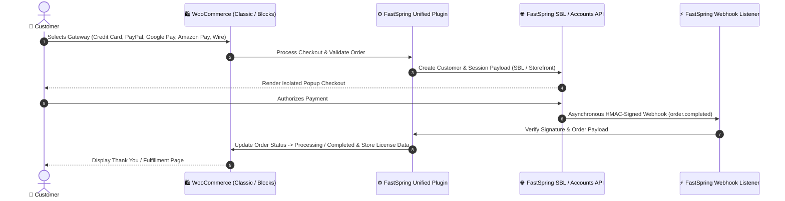

# FastSpring Unified Payment Gateway for WooCommerce

[](https://wordpress.org)
[](https://woocommerce.com)
[](https://www.php.net)
[]()
[]()

An enterprise-grade **FastSpring Payment Gateway & Subscription Management** integration for **WooCommerce**. Engineered to split FastSpring's monolithic hosted checkout into distinct, unbundled payment methods directly within the native WooCommerce checkout experience—while delivering full automated webhook reconciliation, account creation via FastSpring API, and WooCommerce Cart & Checkout Blocks compatibility.

---

## 🏗️ Architecture & Payment Flow



---

## 🌟 Key Technical Capabilities

### 1. 🔀 Split Gateway Architecture
Unlike standard FastSpring integrations that force shoppers into a generic hosted page, this plugin decomposes FastSpring into isolated WooCommerce gateway instances:
- **Credit Card / Debit Card**
- **PayPal Express**
- **Google Pay**
- **Amazon Pay**
- **Wire Transfer / ACH**

Each gateway maintains independent admin controls, title overrides, custom SVG payment badges, and display ordering.

### 2. 🧱 Modern WooCommerce Blocks Compatibility
- Fully integrated with WooCommerce Cart & Checkout Blocks via `@woocommerce/blocks-registry` and PHP block integration classes.
- Zero checkout friction across both modern Gutenberg-based checkouts and legacy shortcode templates.

### 3. 🔄 Complete Subscription Lifecycle Management
Full compatibility with **WooCommerce Subscriptions**:
- **Automated Lifecycle Sync:** Real-time state synchronization for subscription activation, cancellation, suspension, and reactivation.
- **Dynamic Adjustments:** Seamless webhook processing for recurring subscription price adjustments and billing cycle alterations.

### 4. 👤 Automated Account Provisioning via FastSpring API
- Integrates with FastSpring Accounts API (`class-wc-fastspring-customer-creation.php`) to automatically provision or link FastSpring customer records when users register on WooCommerce.

### 5. 🛡️ Enterprise Security & Webhook Reconciliation
- **HMAC RSA-2048 Verification:** Webhook payloads are verified against the configured FastSpring private key before updating order state.
- **Idempotent Order Handling:** Defense-in-depth protection against duplicate webhook deliveries.
- **Audit Logging:** System debug logging via `WC_Logger` with sensitive token masking.

---

## 📂 Directory Layout

```
├── assets/                          # Payment SVG brand icons and checkout styling
├── docs/                            # Integration guides and webhook specifications
├── includes/
│   ├── admin/                       # Gateway settings pages and admin tabs
│   ├── class-fastspring-sub-gateways.php      # Split gateway registration engine
│   ├── class-wc-fastspring-customer-creation.php # FastSpring Accounts API sync
│   ├── class-wc-fastspring-express-checkout.php   # Express checkout handlers
│   ├── class-wc-fastspring-order-flow.php         # Order lifecycle transition handlers
│   ├── class-wc-gateway-fastspring-builder.php    # Checkout payload builder
│   ├── class-wc-gateway-fastspring-handler.php    # Webhook listener & signature validation
│   └── class-wc-gateway-fastspring.php            # Primary gateway core
├── readme.txt                       # WordPress.org standard metadata
├── woocommerce-gateway-fastspring.php # Plugin bootstrap file
└── uninstall.php                    # Clean database purge on plugin removal
```

---

## ⚙️ Requirements & Compatibility

| Platform / Dependency | Supported Version |
|---|---|
| **WordPress** | 6.0+ (Tested up to 6.6+) |
| **WooCommerce** | 3.0.0+ (Tested up to 9.x) |
| **PHP** | 8.0 / 8.1 / 8.2 / 8.3 |
| **Dependencies** | `openssl`, `curl`, `json` PHP extensions |
| **SSL** | Required for production Webhook and SBL communication |

---

## 🚀 Installation & Configuration

### 1. Installation
1. Download or package the plugin directory into `fastspring-unified-wp-plugin.zip`.
2. In your WordPress admin, navigate to **Plugins $\rightarrow$ Add New $\rightarrow$ Upload Plugin**.
3. Choose the ZIP archive and click **Install Now**, then **Activate Plugin**.

### 2. FastSpring API Credentials Setup
1. In WordPress Admin, navigate to **WooCommerce $\rightarrow$ Settings $\rightarrow$ Payments $\rightarrow$ FastSpring**.
2. Configure the following parameters:
   - **Storefront Path:** Your FastSpring storefront identifier (e.g., `company.onfastspring.com/store`).
   - **API Access Key:** FastSpring API credential username.
   - **Private Key:** RSA private key configured in your FastSpring Dashboard for payload decryption.
   - **Sandbox Mode:** Toggle enabled for staging/development testing.
3. Configure your Webhook URL in your FastSpring Dashboard pointing to:
   ```
   https://yourdomain.com/?wc-api=wc_gateway_fastspring
   ```

---

## 🧪 Testing & Verification

- **Sandbox Transactions:** Toggle "Test Mode" to run test checkouts using FastSpring test credit cards and simulated subscription cycles.
- **Debug Logs:** Inspect real-time transaction and webhook logs under **WooCommerce $\rightarrow$ Status $\rightarrow$ Logs** (select `fastspring-*`).

---

## 📄 License
This project is licensed under the GNU General Public License v2.0 or later (GPL-2.0+).
